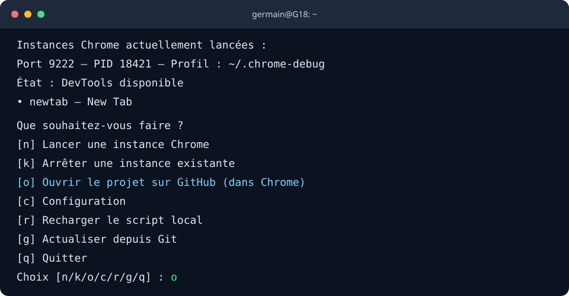
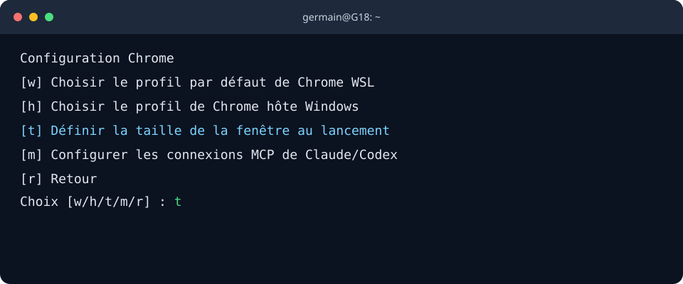
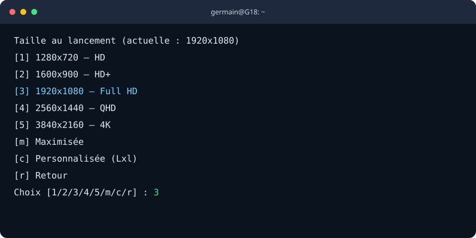

# chromemcp

Lance plusieurs instances Chrome isolées et connecte chacune à une session d’agent via [Chrome DevTools MCP](https://github.com/ChromeDevTools/chrome-devtools-mcp).

Le script est conçu pour Bash sous Linux. La configuration décrite ici a été utilisée sous Debian avec WSL2 et WSLg ; elle peut aussi servir de base sur d’autres distributions.

Exemple fictif. Les titres d’onglets sont visibles ; les PID, ports et noms sont inventés.

```console
$ chrome
Instances Chrome actuellement lancées :
  Port 9222 — PID 18421 — Profil : ~/.chrome-debug
    État : DevTools disponible
    • docs.example.com — Documentation API
    • app.example.com — Tableau de bord local
    • auth.example.com — Tests de connexion
  Port 9922 — PID 18703 — Profil : ~/.chrome-debug-9922
    État : DevTools disponible
    • github.com — Pull requests
    • logs.example.com — Logs de test
Que souhaitez-vous faire ?
  [n] Lancer une instance Chrome
  [k] Arrêter une instance existante
  [o] Ouvrir le projet sur GitHub (dans Chrome)
  [c] Configuration
  [r] Recharger le script local
  [g] Actualiser depuis Git
  [q] Quitter
Choix [n/k/o/c/r/g/q] : k
Instances Chrome disponibles :
  1) port 9222 — PID 18421 — ~/.chrome-debug
     DevTools : disponible
     • docs.example.com — Documentation API
     • app.example.com — Tableau de bord local
     • auth.example.com — Tests de connexion
  2) port 9922 — PID 18703 — ~/.chrome-debug-9922
     DevTools : disponible
     • github.com — Pull requests
     • logs.example.com — Logs de test
Quelle instance arrêter ? (numéro, Entrée pour annuler) 2
Arrêter Chrome sur le port 9922 (PID 18703) ? [y/N] y
Signal d’arrêt envoyé à Chrome sur le port 9922 (PID 18703).

Que souhaitez-vous faire ?
  [n] Lancer une instance Chrome
  [o] Ouvrir le projet sur GitHub (dans Chrome)
  [c] Configuration
  [r] Recharger le script local
  [g] Actualiser depuis Git
  [q] Quitter
Choix [n/o/c/r/g/q] : q
Session chrome terminée.
```

Le menu principal est illustré ci-dessous ; les informations d’instance sont fictives.



## Fonctions

- `chrome` affiche les instances de débogage déjà lancées : port, PID, profil, état DevTools et titres d’onglets préfixés par leur nom d’hôte.
- Sans port explicite, `chrome` garde le menu ouvert après chaque action. Choisissez `[q] Quitter` pour terminer la session interactive.
- `[o]` ouvre le dépôt `germain-italic/chromemcp` dans l’instance Chrome du port par défaut, dans un nouvel onglet si elle est déjà lancée.
- Sans port explicite, `chrome` propose `[c] Configuration`, `[r] Recharger le script local` pour recharger immédiatement la copie du dépôt sans réseau, et `[g] Actualiser depuis Git` pour faire un `git pull --ff-only` puis recharger `~/.bashrc`.
- Chaque instance utilise un port DevTools et un profil Chrome distincts. Le port par défaut est `9222` ; les autres ports sont choisis dans la plage `9300–9999`. Chrome verrouille un dossier de profil : deux instances simultanées ne peuvent pas partager le même dossier.
- L’option d’arrêt du menu affiche les ports et titres, puis demande le numéro de l’instance et une confirmation.
- La taille au lancement se règle depuis `Configuration` → `[t]`. Full HD (`1920x1080`) est la valeur par défaut ; le réglage s’applique aux nouvelles fenêtres.
- La liste signale les dossiers de profil connus sans instance active ; elle ne les supprime pas.
- DevTools écoute sur `127.0.0.1` uniquement.

## Prérequis

- Bash 4.4 ou plus récent.
- Google Chrome Stable.
- `curl`, `iproute2` (`ss`) et `procps` (`pgrep`).
- Python 3 pour afficher les titres d’onglets. Sans Python, le reste du script fonctionne.
- Node.js 20.19 ou une version LTS plus récente, avec `npx`, pour Chrome DevTools MCP. Vérifiez les [prérequis actuels du serveur](https://github.com/ChromeDevTools/chrome-devtools-mcp#requirements) avant installation.

Sous Debian/WSL2, les outils système s’installent avec :

```bash
sudo apt update
sudo apt install curl iproute2 procps python3
```

Installez Chrome Stable en suivant les [instructions officielles pour Linux](https://www.google.com/chrome/).

## Installation

Clone le dépôt à l’emplacement utilisé dans les exemples :

```bash
git clone https://github.com/germain-italic/chromemcp.git "$HOME/dev/germain-italic/chromemcp"
```

Ajoutez cette ligne à `~/.bashrc` :

```bash
source "$HOME/dev/germain-italic/chromemcp/chrome.sh"
```

Rechargez la configuration :

```bash
source ~/.bashrc
```

Le script ne modifie pas lui-même `.bashrc`. Adaptez le chemin si vous avez cloné le dépôt ailleurs.

## Configurer les connexions MCP

Le menu `chrome` distingue Chrome lancé dans WSL de Chrome lancé sur Windows. Choisissez `c`, puis `m` :

- `w` configure Chrome WSL sur le port choisi, par exemple `9222`.
- `h` configure Chrome hôte Windows via son mode Remote Debugging. Chrome doit l’avoir activé dans `chrome://inspect/#remote-debugging`.
- Choisissez `b` pour enregistrer les deux cibles dans Codex et Claude Code, ou configurez un seul client.

Dans `Configuration`, choisissez `t` pour définir la taille de la fenêtre WSL au lancement : HD, HD+, Full HD (par défaut), QHD, 4K, maximisée ou personnalisée au format `largeurxhauteur` (par exemple `1366x768`). Le réglage est enregistré dans `$HOME/.config/chromemcp/window-size`.

Les menus apparaissent dans le terminal après avoir choisi `c`, puis `t` :





Les serveurs sont ajoutés à la configuration globale de chaque client. Les cibles Windows sont nommées `chrome-windows` ; les nouvelles cibles WSL `chrome-wsl-PORT`. Une connexion WSL existante sur le port par défaut est conservée. Redémarrez Codex et Claude Code pour charger les changements. Chrome peut demander d’autoriser la connexion de débogage.

Pour Chrome hôte, le script utilise un lanceur MCP natif Windows et Node.js Windows. Il détecte le runtime portable installé dans `%LOCALAPPDATA%\codex-chrome-mcp` ou un `node.exe` disponible sous Windows ; sinon, installez Node.js LTS pour Windows et relancez la configuration. Le menu permet de choisir un dossier `User Data` Windows parmi ceux détectés ou d’en saisir le chemin. Il affiche aussi les sous-profils trouvés. Le chemin reste distinct de celui de Chrome WSL, car les deux systèmes ne doivent pas partager directement un même dossier de profil.

## Utilisation

```bash
chrome                         # ouvre le menu interactif
chrome https://example.org     # ouvre une URL dans la nouvelle instance
chrome 9633                    # lance ou rejoint l'instance sur 9633
chrome 9633 https://example.org
```

Quand vous lancez `chrome` sans port, le menu permet de lancer une instance avec `n`, d’ouvrir le dépôt GitHub dans Chrome avec `o`, d’ouvrir la configuration avec `c`, de recharger la copie locale avec `r`, d’actualiser depuis Git avec `g`, ou de quitter avec `q`. Le menu revient après le lancement ou l’arrêt d’une instance. La configuration permet de choisir les profils WSL et Windows, de régler la taille de lancement et de relier Codex, Claude Code, ou les deux à Chrome WSL et/ou Chrome hôte. Si des instances WSL existent, choisissez `k`, sélectionnez l’instance par son numéro, puis confirmez son arrêt.

Pour recharger les fonctions depuis les fichiers locaux sans toucher au dépôt, choisissez `r`. Pour actualiser le dépôt et recharger les fonctions dans le shell courant, choisissez `g`. La mise à jour utilise `git pull --ff-only` ; elle s’interrompt si une fusion serait nécessaire.

Si `9222` est déjà utilisé et que vous choisissez de lancer, `chrome` sélectionne un port libre dans `9300–9999`. Un port passé en argument, par exemple `chrome 9633`, cible directement cette instance et saute le menu.

Les profils WSL sont enregistrés dans `~/.chrome-debug` pour le port par défaut, puis dans `~/.chrome-debug-PORT` pour les autres ports. Le menu `c` permet de choisir un dossier de données Chrome WSL parmi ceux détectés ou d’en saisir le chemin, puis un sous-profil présent dans ce dossier (`Default`, `Profile 1`, etc.). Le chemin racine est mémorisé dans `~/.config/chromemcp/profile-dir` et le sous-profil dans `~/.config/chromemcp/profile-name` ; ceux de Chrome hôte sont mémorisés dans `~/.config/chromemcp/host-user-data-dir`. Une variable `CHROME_PROFILE_DIR` définie dans l’environnement prend priorité pour Chrome WSL. Les journaux des instances WSL se trouvent dans `chrome.stderr.log`, dans leur profil.

## Réglages

Déclarez ces variables avant la ligne `source` dans `.bashrc` pour remplacer les valeurs par défaut :

| Variable | Valeur par défaut | Rôle |
| --- | --- | --- |
| `CHROME_DEFAULT_PORT` | `9222` | Port de l’instance par défaut |
| `CHROME_PROFILE_DIR` | `$HOME/.chrome-debug` | Répertoire racine des profils |
| `CHROME_PROFILE_CONFIG` | `$HOME/.config/chromemcp/profile-dir` | Fichier où le menu `c` enregistre le profil par défaut |
| `CHROME_PROFILE_NAME` | `Default` | Sous-profil Chrome WSL à ouvrir, par exemple `Profile 1` |
| `CHROME_PROFILE_NAME_CONFIG` | `$HOME/.config/chromemcp/profile-name` | Fichier où le menu `c` enregistre le sous-profil WSL |
| `CHROME_WINDOW_SIZE` | `1920x1080` | Taille de fenêtre WSL au lancement, ou `maximized` |
| `CHROME_WINDOW_SIZE_CONFIG` | `$HOME/.config/chromemcp/window-size` | Fichier où le menu `c` enregistre la taille de fenêtre |
| `CHROME_HOST_USER_DATA_DIR` | Profil Stable de Windows | Dossier de données Windows pour la connexion MCP hôte |
| `CHROME_HOST_PROFILE_CONFIG` | `$HOME/.config/chromemcp/host-user-data-dir` | Fichier où le menu `c` enregistre le dossier Windows |
| `CHROME_HOST_NODE` | détection automatique | Chemin du `node.exe` Windows si son emplacement est personnalisé |
| `CHROME_HOST_MCP_LAUNCHER` | `$HOME/.local/bin/chrome-windows-mcp` | Lanceur MCP pour le Chrome Windows |
| `CHROME_KEYMAP` | `fr` | Disposition clavier appliquée au lancement ; vide pour la désactiver |
| `CHROME_BIN` | `google-chrome` | Binaire Chrome |
| `CLAUDE_CONFIG_DIR` | `$HOME/.claude` | Répertoire des configurations MCP générées |
| `CHROME_DARK` | `1` | Active l’apparence sombre de l’interface Chrome |
| `CHROME_MCP_COMMAND` | `npx` | Commande qui lance Chrome DevTools MCP |
| `CHROME_DEBUG_PORT` | vide | Port explicite par défaut pour l’appel `chrome` |

Exemple :

```bash
export CHROME_DEFAULT_PORT=9222
export CHROME_DARK=1
source "$HOME/dev/germain-italic/chromemcp/chrome.sh"
```

Sous WSL2, le script vérifie la disponibilité des sockets graphiques Wayland/X11 avant de démarrer Chrome. Il ne déplace pas les fenêtres depuis Windows.

## Dépannage

Vérifiez que DevTools répond sur le port attendu :

```bash
curl -s http://127.0.0.1:9222/json/version
```

La réponse doit contenir une version Chrome et une URL WebSocket. Vérifiez que le serveur MCP utilise le même port. `127.0.0.1` évite les problèmes de résolution IPv6 que `localhost` peut provoquer dans certaines configurations WSL.

Si un port écoute sans endpoint DevTools, le script refuse de démarrer dessus et n’arrête aucun processus à l’aveugle. Identifiez son propriétaire avec :

```bash
ss -ltnp 'sport = :9222'
```

Si DevTools répond mais qu’aucune fenêtre n’apparaît, vérifiez que Chrome n’est pas masqué derrière une autre fenêtre, puis consultez `chrome.stderr.log` dans le profil concerné. Pour redémarrer complètement WSL, utilisez `wsl --shutdown` depuis PowerShell uniquement après avoir enregistré votre travail : cette commande ferme toutes les distributions WSL et leurs processus.

## Confidentialité

Chrome DevTools MCP peut lire et modifier les données accessibles dans les onglets de l’instance connectée. Évitez de le connecter à un profil contenant des données sensibles si l’agent n’en a pas besoin. Les configurations générées désactivent les statistiques d’utilisation avec `--no-usage-statistics` ; consultez la [documentation officielle](https://github.com/ChromeDevTools/chrome-devtools-mcp#disclaimers) pour les détails.

## Licence

Ce projet est distribué sous licence MIT. Voir [LICENSE](LICENSE).

## Documentation complémentaire

Voir la [feuille de route](ROADMAP.md) pour les évolutions prévues.

